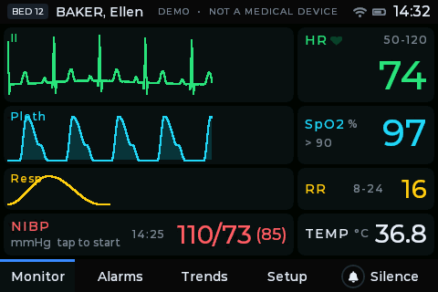
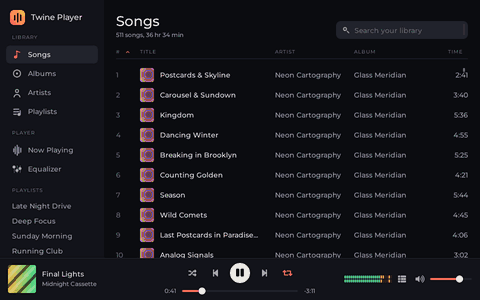
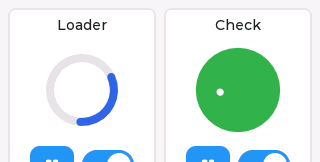
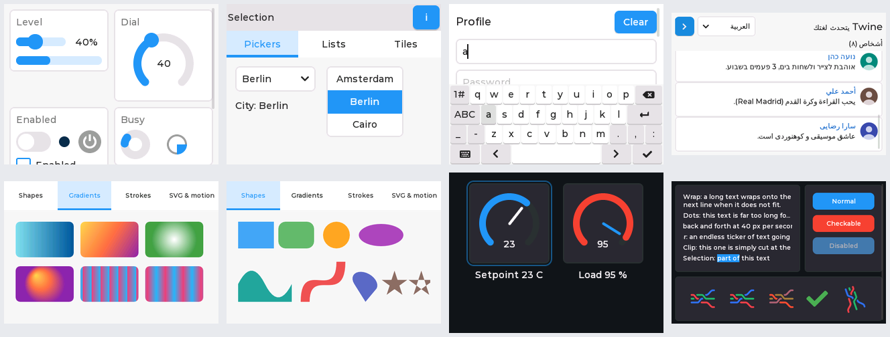

<p align="center">
  
</p>

<h1 align="center">Twine</h1>

**A declarative, signal-driven GUI library in Rust for microcontrollers and desktops.**

Twine targets **feature parity with LVGL v9** — widgets, styles, themes, flex and grid layout,
animations, fonts, images, vector graphics — behind a **Rust-native, SwiftUI-like API** built
on **fine-grained reactive signals**. The same app runs on a Cortex-M0+ with 264 KiB of RAM, on
an ESP32-S3 driving a QSPI AMOLED and in a window on Linux, macOS or Windows.

<p align="center">
  
</p>

> **Status: pre-alpha.** The library is under active development and the API may still change
> before the first release.

## Why Twine

- **Signals, not diffing.** Your app function runs once. Every dynamic value is a binding, so
  a change updates exactly the affected widget properties and redraws exactly their pixels.
  An idle UI executes no code at all (0 % CPU).
- **Built for small chips.** `no_std` + `alloc` everywhere, down to `thumbv6m` (RP2040, no
  atomic compare-and-swap). An integer-only, deterministic renderer draws identical pixels on
  every platform; partial rendering and DMA double buffering keep the bus busy while the CPU
  renders the next chunk.
- **Pay for what you use.** Widgets, image decoders, color formats, fonts, vector graphics,
  Lottie and drivers are cargo features; what you don't enable isn't linked.
- **No OS, executor or chip assumed.** Run it bare metal (`twine::run::blocking`), on
  [embassy](https://embassy.dev) (`twine::embassy::run`), on an RTOS task, or on a desktop
  host. Other tasks and interrupts talk to the UI through interrupt-safe `Channel`s,
  `Latest` cells and `Outbox`es.
- **Ready for certification.** An opt-in safety profile with bounded memory and time, no
  panics in library code, faults instead of crashes, display-integrity checks, partitioned
  runtimes and the evidence an assessor asks for ([details below](#safety-profile)).
- **Testable.** `TestUi` drives an app headless with clicks, keys and time; golden-image tests
  check every pixel; the simulator replays scripts in CI.

## Demos

| | |
|---|---|
|  | **Patient monitor** — a bedside monitor on a 480 × 320 touch panel, the kind of device Twine is built for. ECG, pleth and respiration sweep across the screen like on a real monitor, redrawn a few pixel columns at a time. A simulated desaturation raises prioritised, flashing alarms you can silence, review and trace in the 1–12 h trends; Setup edits alarm limits and the patient and switches between Day, Dark and Night. *A demo, not a medical device.*<br><br>`cargo xtask sim showcase` |
|  | **Twine Player** — a desktop music player built entirely with Twine, running as an ordinary program on Linux, macOS or Windows (960 × 600). A ~500-song library with instant search and sortable columns, generated cover art, a 60 fps 32-band visualizer (bars or a radial spinning record), a 10-band equalizer that glides between presets with a live frequency-response curve, and a slide-in Up Next queue. Audio is simulated, so it runs anywhere.<br><br>`cargo xtask sim desktop` |
|  | **Lottie** — vector animations from After Effects with play/pause, loop and a frame scrubber.<br><br>`cargo xtask sim lottie` |

A tour of the widgets — controls, pickers, the on-screen keyboard, right-to-left Arabic text,
vector gradients and shapes, a custom gauge in dark mode, labels and buttons with the default
theme in dark mode:

<p align="center">
  
</p>

Every demo is a Cargo example of the `twine` crate in
[`crates/twine/examples/`](crates/twine/examples); [all examples](#examples) are listed below.

## A taste of the API

### A counter

```rust
use twine::prelude::*;

fn counter(cx: Scope) -> impl View {
    let count = cx.signal(0u32);

    column((
        label(text!("Clicked {} times", count.get())).font(&fonts::MONTSERRAT_20),
        button(label("Click me")).on_click(move || count.update(|c| *c += 1)),
        button(label("Reset"))
            .disabled(move || count.get() == 0)
            .on_click(move || count.set(0)),
    ))
    .gap(12)
    .padding(16)
    .align_items(CrossAlign::Center)
    .fill()
}

fn main() {
    let window = twine_sim::SimConfig::new(320, 240).title("Counter").scale(2);
    twine_sim::run(window, counter);
}
```

`count.get()` inside `text!` and inside the `disabled` closure makes each of them a binding:
clicking re-runs those two and nothing else. Press F2 in the simulator to see the redrawn
areas.

### Tabs, shared values and live data

```rust
use twine::prelude::*;

fn app(cx: Scope) -> impl View {
    let page = cx.signal(0usize);
    let level = cx.signal(40i32);
    let reading = cx.signal(21i32);
    // A stand-in for a sensor; on a device this is a `Latest` written by an interrupt.
    cx.interval(Duration::ms(500), move || reading.update(|r| *r = 18 + (*r - 17) % 12));

    tabview(page, (
        tab("Level", column((
            // Three widgets, one signal: move any of them and the others follow.
            slider(level).range(0..=100).fill_width(),
            bar(level).animated(Duration::ms(300)).fill_width(),
            label(text!("{}%", level.get())),
        )).gap(12).padding(12)),
        tab("Sensor", label(text!("{} °C", reading.get())).font(&fonts::MONTSERRAT_28)),
    ))
    .bar_position(Side::Bottom)
    .fill()
}
```

### Lists that update in place

```rust
use twine::prelude::*;

#[derive(Clone, PartialEq)]
struct Sensor { id: u32, name: &'static str, value: i32 }

fn sensors(cx: Scope) -> impl View {
    let items = cx.signal(vec![
        Sensor { id: 1, name: "Boiler", value: 64 },
        Sensor { id: 2, name: "Tank", value: 21 },
    ]);
    // One row per key; a row re-runs only when its own `value` changes.
    column(for_each(items, |s| s.id, |_cx, s| {
        let value = s.map(|s| s.value);
        row((label(s.get_untracked().name), label(text!("{} °C", value.get()))))
    }))
}
```

### Data from other tasks, threads and interrupts

```rust
use twine::prelude::*;

/// Written by the ADC interrupt (or a sensor thread): never blocks, wakes the UI.
static TEMPERATURE: Latest<i32> = Latest::new(0);
/// Read by the controller task; the UI never waits for it.
static SETPOINT: Outbox<i32, 4> = Outbox::new().on_full(Overflow::DropOldest);

fn thermostat(cx: Scope) -> impl View {
    let temperature = cx.watch(&TEMPERATURE);
    let target = cx.signal(21);
    cx.effect(move || {
        let _ = SETPOINT.try_send(target.get());
    });
    column((
        label(text!("{} °C", temperature.get())),
        slider(target).range(15..=28),
    ))
}
```

### Tests without a display

```rust
use twine_testing::{TestUi, by_id, by_text};

let mut t = TestUi::new(320, 240).mount(twine_demos::counter::app);
t.find(by_text("Click me")).click();
t.run_until_idle();
assert_eq!(t.find(by_id("count")).text(), "Clicked 1 times");
```

### On a microcontroller

The same app function, on an RP2040 with an SPI panel (from
[`firmware/rp2040`](firmware/rp2040)):

```rust
// Two partial draw buffers in `.bss`: chunk k+1 renders while DMA sends chunk k.
twine::draw_buffers! {
    static BUFS: 2 x 40 rows x 320 px @ Rgb565Swapped;
}

let ui = Ui::builder(display)                    // any `twine_hal::DisplayDriver`
    .runtime(Runtime::take().expect("runtime already taken"))
    .clock(PicoClock)
    .buffers(BufferMode::partial_double_from(BUFS.take().unwrap()))
    .input(touch)                                // any `twine_hal::InputDevice`
    .build(app);
twine::run::blocking(ui, &mut platform)          // sleeps whenever the UI is idle
```

With embassy, `twine::embassy::run(ui).await` replaces the blocking loop.

## Features

| Area | What you get |
|------|--------------|
| **Widgets** | label, button, image button, checkbox, switch, slider, bar, arc, LED, spinner, line, dropdown, roller, list, menu, tab view, tile view, window, message box, text area, on-screen keyboard, spinbox, span group (rich text), vector canvas, button matrix, animated image, Lottie, QR code and barcode — plus your own widgets ([guide](crates/twine/src/guide/custom_widgets.md)) and `#[component]` functions |
| **Layout** | flex (direction, wrap, grow, alignment, gaps) and grid (`Px`, `Content`, `Fr` tracks, spans), scrolling with momentum, snapping, elastic ends and scroll chaining |
| **Styles & themes** | every LVGL style property, typed and per state and part; design elements (`design::PRIMARY`, `SPACE_M`, `RADIUS_L`, …) so apps follow the theme; built-in LVGL-style, monochrome and simple themes in light, dark, night and high-contrast modes, switchable at run time |
| **Animation** | tweens, timelines, easing curves (including overshoot and bounce), style transitions, screen-load animations, a global motion preference (reduced motion) |
| **Text** | Montserrat at 8–48 px, DejaVu, Source Han Sans (CJK), Font Awesome symbols, font fallback, bidirectional text, Arabic and Persian shaping, compile-time translations (`tr!`), selection and editing |
| **Images & graphics** | QOI, PNG, JPEG, GIF, BMP and LZ4 decoders, rotation, scaling and recoloring; gradients, shadows, masks, rounded corners; vector paths, strokes, dashes and SVG icons |
| **Displays & input** | RGB565, RGB888, XRGB8888, ARGB8888, L8 and 1-bit formats; hardware or software rotation; partial, double-buffered, full-frame and direct buffer modes; pointer, keypad, encoder and button inputs with focus groups and gestures |
| **Drivers** | ILI9341, ILI9342, ILI9488, ST7735, ST7789, ST7796, GC9A01, SH8601, CO5300, RM67162, JD9853, SSD1306 and SH1106 panels; XPT2046, FT6x36, GT911, CST816S, AXS5106L and STMPE811 touch; SPI, SPI+DMA, QSPI, I80 and I2C buses; DMA2D on STM32; an `embedded-graphics` adapter |
| **Data flow** | signals, memos, effects, scopes; `Channel`, `Latest` and `Outbox` between the UI and interrupts, tasks or threads; typed navigation with leave guards; modals; context for app-wide stores ([guide](crates/twine/src/guide/app_state.md)) |
| **Tooling** | a desktop simulator with bus-speed emulation, time control and debug overlays; headless scripted runs; `TestUi`; golden-image tests; a performance monitor; font and image converters (`twine-cli`) |

## Runs everywhere

**Microcontrollers.** Twine ships drivers, not board support: every display, touch and input
driver and every bus interface is a cargo feature (`twine/drivers-<name>`: `drivers-spi`,
`drivers-st7789`, `drivers-xpt2046`, …) that you wire to your own board's pins. The
`firmware/` directory holds one small example per chip family — a template with a single
"Wiring: edit for your board" block — that proves the stack builds and fits on that chip:

| Example | Chip | Target | Toolchain |
|---------|------|--------|-----------|
| `firmware/rp2040` | RP2040 | `thumbv6m-none-eabi` | stable |
| `firmware/rp2350` | RP2350 | `thumbv8m.main-none-eabihf` | stable |
| `firmware/stm32f411` | STM32F411 | `thumbv7em-none-eabihf` | stable |
| `firmware/stm32f429i-disco` | STM32F429I-DISC1 (LTDC framebuffers + DMA2D) | `thumbv7em-none-eabihf` | stable |
| `firmware/esp32c3` | ESP32-C3 | `riscv32imc-unknown-none-elf` | stable |
| `firmware/esp32c6` | ESP32-C6 | `riscv32imac-unknown-none-elf` | stable |
| `firmware/esp32s3` | ESP32-S3 (SPI panels and QSPI AMOLEDs) | `xtensa-esp32s3-none-elf` | `esp` (espup) |
| `firmware/esp32` | ESP32 | `xtensa-esp32-none-elf` | `esp` (espup) |

[`firmware/README.md`](firmware/README.md) lists the pins and features for known boards (the
common 2.8" ILI9341 + XPT2046 module, the ESP32 "Cheap Yellow Display", Waveshare and LilyGO
ESP32-S3 AMOLED boards, Waveshare's ESP32-C6 1.47" LCD) and the hardware checklist.

**Desktop: Linux, macOS and Windows.** Yes, you can use Twine as the UI library of a regular
Rust program. `twine-sim` opens a native window (winit + softbuffer, pure Rust, no SDL) and
runs your app in it, with the standard library, threads and files at hand — the
[`desktop`](crates/twine/examples/desktop) example, **Twine Player**, is a complete music
player built this way (`cargo xtask sim desktop`): a ~500-song library with search and
sorting, generated cover art, a 32-band visualizer, a 10-band equalizer and a queue, styled
by its own theme and driven by one frame clock:

```rust
// Abridged from crates/twine/examples/desktop/main.rs and player.rs.
fn app(cx: Scope) -> impl View {
    let app = App { player: Player::new(cx, /* … */), eq: Equalizer::new(cx), /* … */ };
    // One 16 ms timer advances playback, eases the equalizer and feeds the visualizer.
    app.player.run(cx, app.eq);
    column((row((sidebar(app), pages)), transport::bar(cx, app), queue::panel(cx, app, 516)))
        .focusable(true) // the window owns the keyboard shortcuts
        .on_key(move |k| shortcut(app, k))
}

fn main() {
    let window = SimConfig::new(960, 600).title("Twine Player").format(ColorFormat::Xrgb8888);
    twine_sim::run(window.theme(theme::theme()), app);
}
```

The window has a fixed logical size with integer scaling (`.scale(2)`): Twine draws its own
widgets pixel-exactly, the same way it does on a panel — there are no native controls,
resizable layouts or system clipboard yet. For kiosks and appliances without a window system,
the [`linux_fbdev`](crates/twine/examples/linux_fbdev.rs) example drives `/dev/fb0` and an
`evdev` touchscreen directly.

**embedded-graphics.** Projects already built on [embedded-graphics] can draw Twine through
the `twine-embedded-graphics` adapter (`cargo xtask sim eg_simulator`).

[embedded-graphics]: https://docs.rs/embedded-graphics

## Examples

Run any example with `cargo xtask sim <name>` (the same as `cargo run -p twine --example
<name>`). Each one has a headless script in
[`crates/twine/examples/scripts/`](crates/twine/examples/scripts) that CI replays.

| Example | Shows |
|---------|-------|
| `showcase` | a bedside patient monitor (demo, not a medical device): sweep waveforms redrawn column by column, prioritised alarms, trends, Day / Dark / Night |
| `desktop` | Twine Player, a desktop music player: a virtualized, searchable, sortable library; generated cover art; a 32-band visualizer; a 10-band equalizer with its response curve; a keyed queue; keyboard shortcuts |
| `hello`, `counter` | the smallest apps: one label; signals and click handlers |
| `controls`, `core_widgets`, `selection`, `text_input` | every widget, in the default theme |
| `navigation`, `when_demo` | typed navigation with screen animations and leave guards; conditional views |
| `thermostat`, `todo_list` | data from other threads (`Latest`, `Outbox`); the store pattern |
| `gauge` | a custom widget with its own class, parts, drawing and theme |
| `flex_layout`, `grid_layout`, `layout_views`, `scroll` | interactive layout and scrolling playgrounds |
| `anim_gallery`, `spinner` | easing curves, transitions, screen animations; the smooth-animation benchmark |
| `text_gallery`, `multilang` | fonts and text; eight languages, right-to-left, Arabic shaping, CJK |
| `image_gallery`, `render_gallery`, `vector`, `lottie` | images, the software renderer, vector graphics and SVG, Lottie |
| `partitions` | two isolated UIs side by side, each with its own runtime (feature `partitions`) |
| `engine_boxes`, `engine_input` | the engine's imperative API: refresh pipeline and input system |
| `linux_fbdev`, `rtos_notify`, `reactive_console`, `style_resolve` | Linux framebuffer; the RTOS run loop; console walk-throughs |

The demo apps behind the board firmware live in [`crates/twine-demos`](crates/twine-demos),
shared by the simulator, the firmware and the tests.

## Guides

- **Writing a custom widget** (`twine::guide::custom_widgets`,
  [source](crates/twine/src/guide/custom_widgets.md)): a gauge with its own class and parts,
  drawing, keypad/encoder input, theming with design elements in every theme mode, a typed
  view, animations within the motion preference, and tests — the `gauge` example. Its last
  section covers **components** (`#[component]`): a function composing views, used like a
  built-in widget (`meter(rpm).range(0..=8000).padding(4)`).
- **Application state** (`twine::guide::app_state`,
  [source](crates/twine/src/guide/app_state.md)): the store pattern for large applications —
  a `Copy` struct of signals and memos with action methods, provided as context
  (`cx.provide(store)`) and read by any component (`cx.expect_context::<Store>()`, or
  `use_context` returning a `Result`); scoped stores, testing with `TestUi`, stores fed by
  ports — the `todo_list` example.

## Safety profile

Twine is architected for certifiable products but tied to no standard: it provides
mechanisms (faults, limits, hooks, evidence), the application owns the policy.

- **`twine/safety`** refuses the parts unsuited to certifiable products (floating point,
  run-time files and fonts, the performance overlay) at compile time and denies panicking
  code in the library: no unchecked indexing, no unchecked overflow, no `unwrap`. Every
  remaining panic site is listed in [`docs/safety/panics.md`](docs/safety/panics.md).
- **Bounded memory and time.** Preallocated `Limits` bound every growing structure;
  `Ui::seal()` turns any later allocation into a fault; a step budget bounds each update and
  reports overruns; arena generations widen to 48 bits so no handle is ever reused within a
  product's lifetime.
- **Faults, not crashes.** Reactive misuse, full queues and exceeded limits raise typed
  faults that the application handles; `Result`-returning constructors and lookups.
- **Display integrity** (`twine/display-integrity`, implied by `safety`): CRC checks of
  rendered regions, read-back from the panel, a heartbeat and a fail-safe screen.
- **Partitioned runtimes** (`twine/partitions`, opt-in): two independent UIs in one
  image — e.g. a safety-critical display next to a non-critical one — each with its own
  runtime, limits, faults, seal, step budget and heartbeat, so a fault in one cannot change
  the other (`cargo xtask sim partitions`). Zero cost without the feature.
- **Evidence.** `AppConfig::audit_report` dumps the configuration; requirements, a
  traceability matrix, coverage (MC/DC) and the safety manual live in
  [`docs/safety/`](docs/safety/profile.md).

## Crate map

Crates are strictly layered: a crate only depends on crates below it (`cargo xtask layers`
enforces this). Applications depend on the `twine` facade only.

| Crate | Role |
|-------|------|
| `twine-core` | geometry, fixed-point math, colors & pixel formats, time, arenas, `RectSet`, logging |
| `twine-hal` | display / input / clock / platform traits (opt-in `platform-*` implementations) |
| `twine-reactive` | signals, memos, effects, scopes, channels |
| `twine-anim` | animations, easing, timelines, timers |
| `twine-render` | integer software renderer |
| `twine-text`, `twine-image`, `twine-vector`, `twine-fs` | fonts & text, images & decoders, vector/SVG, file systems |
| `twine-assets` | built-in fonts |
| `twine-style`, `twine-layout` | style system and design elements, flex & grid layout |
| `twine-engine` | widget tree, events, input, scrolling, invalidation, refresh pipeline |
| `twine-theme`, `twine-widgets`, `twine-widgets-ext` | themes, basic and complex widgets |
| `twine-extra`, `twine-lottie` | QR codes, barcodes, translations; Lottie animations |
| `twine-view` | declarative view layer, `Ui` runtime and the blocking run loop (`twine::run`) |
| `twine-macros` | `#[component]` (host-only proc macro, re-exported by `twine-view` and the facade) |
| `twine` | facade: re-exports and `prelude` |
| `twine-drivers`, `twine-embassy`, `twine-esp`, `twine-accel-stm32`, `twine-embedded-graphics` | drivers, embassy run loop (`Ui` and `AsyncUi`), esp-hal QSPI adapter, DMA2D, embedded-graphics adapter |
| `twine-sim`, `twine-testing`, `twine-demos` | desktop simulator and window host, test harnesses, demo apps |

Tools: `twine-cli` (font and image converters), `twine-bench` (benchmarks), `xtask`
(CI and project commands).

## Building

Prerequisites:

- [`rustup`](https://rustup.rs) — `rust-toolchain.toml` installs stable plus the embedded targets.
- Optional: [`cargo-llvm-cov`](https://github.com/taiki-e/cargo-llvm-cov)
  (`cargo install cargo-llvm-cov`) for `cargo xtask coverage`; a nightly toolchain with Miri
  (`rustup toolchain install nightly --component miri`) for `cargo xtask miri`;
  [`probe-rs`](https://probe.rs) to flash ARM/RP boards; [`espup`](https://github.com/esp-rs/espup)
  for the Xtensa (ESP32, ESP32-S3) toolchain.

Commands:

| Command | What it does |
|---------|--------------|
| `cargo xtask ci` | everything CI runs (fmt, clippy, the safety profile, tests, no_std builds, docs, Miri, snapshots, firmware); `--quick` skips the slow stages, `--only <stage>` runs single stages |
| `cargo xtask sim <example>` | run a simulator example (`--release`, `--headless`, `--script <file>`) |
| `cargo xtask sim-smoke` | run every simulator example headless |
| `cargo xtask snapshots [--check\|--propose\|--accept]` | run the golden-image tests against the committed hash manifests / propose and approve new references (review diffs first) |
| `cargo xtask nostd` | build the `no_std` crates for all embedded targets |
| `cargo xtask firmware [example] [--strict]` | build the example firmware and print flash/RAM sizes |
| `cargo xtask coverage [--mcdc]` | per-crate line coverage with thresholds; MC/DC of the core crates (nightly) |
| `cargo xtask traceability` | requirements → tests matrix of the safety profile |
| `cargo xtask miri [crate…]` | run tests under Miri (nightly) to detect undefined behaviour |

Logging: `RUST_LOG=twine=debug` enables logs in the simulator and tests
(`twine::refresh=trace` shows invalidations).

## Simulator

`cargo xtask sim <example>` opens a desktop window that emulates the panel's pixel format,
bus speed and input devices (mouse as touch, keyboard as keypad, wheel as encoder). F1 lists
the debug hotkeys: refresh areas (F2), layout bounds (F3), the performance overlay (F4), slow
motion, pause and single step (F5–F7), a tree dump (F8), screenshots (F9), frame recording
(F10) and the next theme mode (F12).

The simulator also runs headless with `.twinescript` scripts (taps, drags, keys, text,
screenshots) for CI smoke runs and snapshot tests, with full control of time.
`TWINE_SIM_SCALE`, `TWINE_SIM_FORMAT`, `TWINE_SIM_BUS_HZ`, `TWINE_SIM_ROTATION` and
`TWINE_SIM_BUFFERS` override the configuration without recompiling.

For [embedded-graphics] projects, `cargo xtask sim eg_simulator` runs the counter demo inside
`embedded-graphics-simulator` through the `twine-embedded-graphics` adapter. It needs SDL2
(`brew install sdl2` on macOS, `apt install libsdl2-dev` on Linux); `cargo xtask ci` skips it
with a warning when SDL2 is missing.

## License

Licensed under either of [Apache License, Version 2.0](LICENSE-APACHE) or
[MIT license](LICENSE-MIT) at your option.
